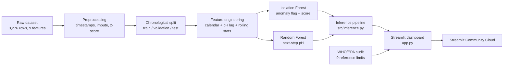

# AquaSense AI: Underwater Water-Quality Analytics

**Technology Innovation Hub (TIH), Indian Institute of Technology Guwahati**
**AI/ML Internship Programme (Cohort 4)**

| | |
|---|---|
| **Candidate** | Meshwa Hirpara |
| **Group** | C1 |
| **Target Repository** | `MeshwaHirpara_C1_ONLINETIHIITG` |
| **Assigned Mentor** | [Sushil Meher](https://www.linkedin.com/in/nightcoder44332211/), Teaching Assistant, Indian Institute of Technology Guwahati |
| **Live Application** | https://meshwahirparac1onlinetihiitg-8yqrvmjpaag5ynq9cfuecr.streamlit.app/ |
| **Health Probe** | https://meshwahirparac1onlinetihiitg-8yqrvmjpaag5ynq9cfuecr.streamlit.app/_stcore/health |

## Overview

AquaSense AI is an AI/ML system for time-stamped water-quality observations. It does two things:

1. **Anomaly detection:** flags unusual observations with a tuned Isolation Forest.
2. **Next-step pH forecasting:** predicts the next pH value with a tuned Random Forest Regressor.

An interactive dashboard lets you test readings live, replay telemetry, process CSV files in batch, and compare the models with baselines. A deterministic WHO/EPA reference audit runs alongside the models.

## Architecture



## Dataset

- 3,276 observations, 9 physicochemical features: pH, Hardness, Solids, Chloramines, Sulfate, Conductivity, Organic carbon, Trihalomethanes, Turbidity.
- Missing values: pH (491), Sulfate (781), Trihalomethanes (162).
- Chronological split: train 2,291, validation 491, test 491. The test set was untouched until the models were frozen.
- **Timestamps are synthetic.** The original data has no real timestamps, and temperature, dissolved oxygen and pressure are not available.

## Method

| Stage | Detail |
|---|---|
| Preprocessing | Imputation and z-score standardisation fitted on training data |
| Temporal features | hour, day of week, day, month, pH lag 1, rolling mean and std (window 3) |
| Anomaly model | Isolation Forest (contamination 0.03, max_samples 512), 27 configurations explored |
| Anomaly baseline | Z-score statistical rule |
| Forecast model | Random Forest (300 trees, max depth 5, min split 5, min leaf 2), 36 configurations explored |
| Forecast baseline | Persistence (next pH = current pH) |
| Validation | Chronological expanding-window validation, feature ablation, validation-only tuning, single test evaluation |

## Results (held-out test split)

| Task | Method | Result |
|---|---|---|
| Anomaly detection | Tuned Isolation Forest | 2.44% flagged (12 of 491) |
| Anomaly detection | Z-score baseline | 4.89% flagged (24 of 491) |
| Forecasting | Tuned Random Forest | MAE 0.9694, RMSE 1.2379 |
| Forecasting | Persistence baseline | MAE 1.1327, RMSE 1.6087 |

Errors are in standardised units (1 unit is about 1.52 pH).

**Important caveats**

- The forecast beats persistence by 14.4% MAE, but beats a constant "predict the training mean" model by only 0.4%. pH at consecutive steps is barely correlated (0.17), so the dataset has weak temporal structure.
- There are no ground-truth anomaly labels, so the anomaly rate is descriptive, not an accuracy score.
- Results demonstrate the methodology and should not be read as validation on real underwater sensor streams.

## Dashboard features

- **Interactive Simulator:** nine sliders, presets (Dataset Median, Mountain Spring, Municipal Tap, Industrial Runoff, Acid Drainage, Sensor Failure), live anomaly verdict, next-step pH, latency and a z-score deviation chart.
- **Continuous Telemetry Stream:** replay of the test split with observed pH, forecast and flagged points.
- **Batch Telemetry Processor:** upload a CSV (raw or standardised units) and download flags, scores and forecasts.
- **Model Benchmark and WHO Standards:** saved results, baseline check, ablation, tuning log and reference limits.
- **WHO/EPA reference audit:** nine guideline limits. These are educational reference values, editable in `src/aquaguard.py`, and not a regulatory determination.

## Run locally

```bash
pip install -r requirements.txt
streamlit run app.py
```

Score a CSV from the command line:

```bash
python -m src.inference
```

## Repository layout

| Path | Contents |
|---|---|
| `app.py` | Dashboard (previous sidebar version: `app_legacy.py`) |
| `src/` | preprocessing, anomaly detection, forecasting, inference, `aquaguard.py` (dashboard core) |
| `artifacts/day22_final/` | Frozen models, feature config, recovered scaler |
| `data/` | Raw and processed datasets |
| `experiments/` | Tuning logs, validation results, saved inference output |
| `notebook/` | Day-by-day analysis notebooks |
| `docs/` | Methodology, risk checklist, results notes |
| `report/` | Project report |

## Limitations

- Synthetic timestamps; no real sensor stream.
- Temperature, dissolved oxygen and pressure are absent from the dataset.
- No anomaly labels, so precision, recall and F1 cannot be computed.
- Weak temporal structure limits forecasting value (see caveats above).
- The original scaler was not saved; the dashboard uses parameters recovered exactly from the processed data (`artifacts/day22_final/scaler_recovered.json`).
- WHO/EPA limits are educational reference values; verify against local standards.

## Disclaimer

This is an educational research prototype trained on a public benchmark dataset. It is not a certified water-safety system and is not a substitute for laboratory testing. Drinking-water decisions must be validated by licensed local testing authorities.
